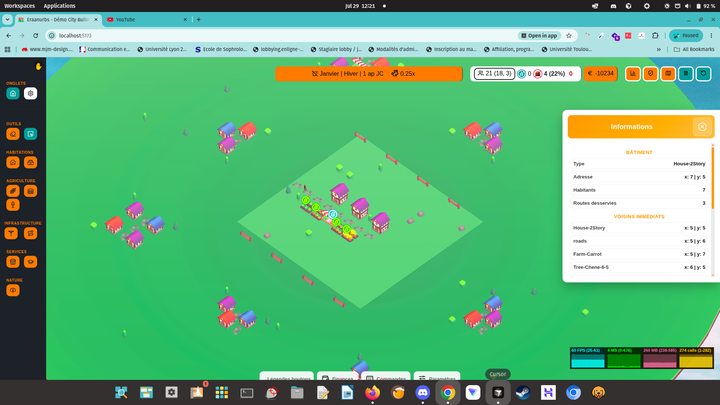

# Règle métier (Employment bounded context)

À chaque tour de redistribution (mensuel), le bounded context **Employment** remplit les bâtiments qui peuvent employer des travailleurs à partir de la main-d'œuvre disponible dans les maisons.

---

## 1. Population : citoyens, élites, total

### 1.1 Persistance (`pop` en base)

- **`pop`** = population **totale** d’une maison = **citoyens + élites**.
- Les **élites mangent** : la consommation alimentaire s’applique à `pop` entier (élites incluses).
- Seules les maisons avec **`roadCount > 0`** contribuent aux agrégats ville (pool, barre d’état).

### 1.2 Maisons ordinaires

- Toute la `pop` est **citoyenne** (ouvriers éligibles).
- Capacité : **6** citoyens max (`pop` max = 6).
- Élites : **0**.

### 1.4 Affichage barre d’état

Deux barres :

**Barre principale** — pop totale + affamés :
- 👥 **`totalPopulation`** (active + chômeurs)

**Barre détail** (sous la principale) — pop active + emploi :
- **👷** `activePopulationCount` · *écart* · 🔨 citoyens · 👑 élites · 🏛 fonctionnaires
- **Chômeurs** `unemployed (%)` — hors fonctionnaires
- **⚠️** postes non pourvus (`lack`)

```
total = population active + chômeurs
```

Exemple : barre 1 → **`21`** · barre 2 → 👷 **`6`** · 🔨`5` 👑`0` 🏛`1` · chômage **`15 (75 %)`** · ⚠️`0`

---

## 2. Pool ouvrier vs pool élite

| Métrique | Définition | Utilisation |
|---|---|---|
| **`workerPool`** | Σ citoyens des maisons avec route | Redistribution `employees.worker`, chômage ouvrier |
| **`elitePool`** | Σ élites des palais avec route | Affichage ; futur chômage élite *(à faire)* |
| **`totalPopulation`** | `workerPool + elitePool` | Affichage total |

Règles strictes :

- Les **élites ne prennent pas** les postes `worker` (`workerNeed` / `employees.worker`).
- Les **élites ne sont pas comptées** dans le pool ouvrier ni dans le chômage classique.
- La redistribution mensuelle (`DistributeCityWorkers`) ne consomme que le **`workerPool`**.

---

## 3. Postes à pourvoir

- Un **poste ouvrier** est un bâtiment **non-maison**, **non-route**, avec `workerNeed > 0`.
- **Fermes** (`Farm-*`) : éligibles **sans route** — embauche et agrégats (manque, no-work) dès la pose.
- **Autres postes** (marché, moulin, usine…) : `roadCount > 0` requis.

### 3 bis. Éligibilité route

- Maisons : seules celles avec route contribuent au pool ouvrier.
- Fermes : exemptées (pas de route requise pour emploi).
- Autres postes sans route : ignorés pour manque, chômage-allocation et icônes `no-work`.

---

## 4. Redistribution (gloutonne par priorité)

1. Réinitialiser tous les postes : `employees.worker = 0` (conserver `workerNeed`, `sector`).
2. Trier les postes par **priorité de secteur** (1 = la plus haute).
3. Pour chaque poste éligible (avec route) :
   - affecter `min(besoin restant, pool restant)`
   - ne jamais dépasser `workerNeed`
   - s’arrêter quand le pool ouvrier est épuisé.

---

## 5. Chômage ouvrier vs manque global

Deux métriques **indépendantes** — ne pas les confondre.

### 5.1 Chômage classique (surplus de main-d’œuvre)

Mesure les **citoyens ouvriers non assignés**, hors fonctionnaires et hors élites.

```
civilServantCount = floor(totalPopulation / 12)
laborPool         = max(0, workerPool − civilServantCount)
totalAssigned     = Σ employees.worker   (postes éligibles, avec route)
unemployed        = max(0, laborPool − totalAssigned)
unemploymentPercentage = round(unemployed / laborPool × 100)   si laborPool > 0, sinon 0
```

- **Numérateur** : citoyens sans emploi ouvrier, **sans compter les fonctionnaires**.
- **Dénominateur** : **`laborPool`** — pool ouvrier après réservation des fonctionnaires ; les élites sont **exclues**.
- Affichage barre : **`unemployed (unemploymentPercentage %)`** — ex. `4 (9 %)`.

### 5.2 Manque global (déficit sur les postes)

Mesure les **postes ouvriers non pourvus** (y compris sous-effectif partiel) sur les bâtiments éligibles.

```
lack = Σ max(0, workerNeed − employees.worker)   (postes éligibles, avec route)
```

- Affichage : chiffre rouge seul (ex. `5`), sans icône dédiée dans la barre.
- **Ne pas confondre avec les icônes `no-work`** : voir §5.4.

### 5.3 Après redistribution gloutonne

| Situation | Chômage | Manque | Exemple |
|---|---|---|---|
| Plus d’ouvriers que de postes | > 0 | 0 | 18 citoyens, 14 emplois pourvus → `4 (22 %)`, manque `0` |
| Plus de postes que d’ouvriers | 0 | > 0 | 10 citoyens, 15 postes → chômage `0`, manque `5` |

Chômage > 0 et manque > 0 **en même temps** n’existe pas après une redistribution complète : si des citoyens restent sans emploi, tous les postes éligibles sont déjà pourvus (`lack = 0`).

### 5.4 Icônes `no-work` (présentation 3D)

Condition (`computeCityEmploymentSummary` → `understaffedBuildingIds`) :

```
worker === 0  AND  workerNeed > 0  AND  isEligibleWorkplace(building)
```

(`isEligibleWorkplace` = ferme sans route OK ; autres postes → `roadCount > 0`.)

- Affichées **uniquement** par `scene.refreshEmploymentPresentation` (pas par `scene.update`).
- Un poste à **1/3 ouvriers** contribue au **manque** (`lack`) mais **n’a pas** d’icône `no-work`.
- Clé bâtiment : `instanceId` (UUID).

Flux et entry points : [`presentation.md`](presentation.md).

### 5.5 Exemple vérifié (partie réelle)

Capture du modèle en jeu — barre d’état et détail d’un palais (`pop = 7`) :

<figure>
  <a href="assets/employment_model.png" title="Ouvrir la capture en pleine résolution (1920×1080)">
    
  </a>
  <figcaption>
    <strong>Barre d'état</strong> : population <code>21 (18, 3)</code> · chômage ouvrier <code>4 (22 %)</code> · manque <code>0</code>.
    <strong>Panel</strong> : palais sélectionné, <code>pop = 7</code> (6 citoyens + 1 élite).
    · <a href="assets/employment_model.png">Agrandir la capture</a> (1920×1080)
  </figcaption>
</figure>

3 palais (`pop = 7` chacun) + 4 fermes (`workerNeed = 3`) + 1 marché (`workerNeed = 2`), tout routé :

| Métrique | Calcul | Valeur |
|---|---|---|
| Citoyens (`workerPool`) | 3 × 6 | **18** |
| Élites (`elitePool`) | 3 × 1 | **3** |
| Total | 18 + 3 | **21** → affichage `21 (18, 3)` |
| Emplois pourvus (`totalAssigned`) | 4×3 + 1×2 | **14** |
| Chômeurs (`unemployed`) | 18 − 14 | **4** |
| Taux chômage | round(4 / 18 × 100) | **22 %** → affichage `4 (22 %)` |
| Manque (`lack`) | tous postes pourvus | **0** |

### 5.6 Une compétence appartient à une seule catégorie sociale (éviter les postes partagés)

Le panneau « Emploi » lit, **par catégorie**, qui est au chômage et quels postes restent vides (grille 🎓 🪑 🛣️ 🧩 🧍 sous chaque taux). Un poste vide
est rattaché à une catégorie par **la compétence qu'il demande** (`groupsForSkill`), jamais par un secteur : les secteurs servent à d'autres leviers,
pas au chômage.

- **Une compétence, une catégorie :** le rattachement est exact. Les postes vides de la compétence vont à cette catégorie.
- **Une compétence accordée par plusieurs catégories :** on ne peut plus dire à qui appartient un poste vide. Le code les répartit à parts égales
  (`vacanciesShareOf`, `src/composition/hudPopulationAggregates.js`) : la somme des catégories reste exacte, mais **pas** la part de chacune. Une catégorie
  affiche moins de postes qu'elle n'en prendrait, ses chômeurs paraissent « sans poste » alors qu'ils sont à une embauche près ; une autre en affiche trop.
  Le joueur est trompé là où l'écran doit l'éclairer.
- **Le correctif honnête** (répartir au prorata de ceux qui occupent déjà les postes de cette compétence, via `workerSources`) n'a rien à lire avant la
  première embauche : il faudrait une règle « personne encore » (un repli, ou « … »). Plus de mécanique pour réparer ce qu'on peut éviter.
- Un poste partagé brouille aussi les raisons de sous-effectif d'un bâtiment (« qui détient la compétence demandée ») et les onglets de priorité (`shared`).

### 5.7 Les hameaux : un seul est vivant à la fois

La répartition des travailleurs ne tourne que pour **le hameau affiché** (`isActiveHamletRow`, `DexieEmploymentBuildingRepository`) : un hameau non visité est **gelé** et garde les travailleurs de sa dernière visite. C'est voulu (une scène à la fois).

- Le panneau d'admin « Allocation de la Main-d'œuvre » règle les priorités **du hameau où l'on est** (rangées sur la ligne du hameau, `employmentSkillPriorities`) ; pour un autre hameau, il faut s'y rendre. Une bannière nomme le hameau.
- La vue « pays » du panneau Emploi additionne tous les hameaux : ceux qui ne sont pas visités y figurent **avec leurs chiffres gelés**, ce qui reste utile à lire. Ne pas la lire comme un état courant.

**Règle :** ne pas créer de compétence accordée par deux catégories. Si un besoin de design l'exige vraiment, décider d'abord comment ses postes sont
attribués, avant de toucher au catalogue. Aucune compétence n'est partagée aujourd'hui.

---

## 6. Chômage élite *(à faire)*

- Métrique **distincte** du chômage ouvrier.
- Basée sur `elitePool` et les postes `elite_need` / `employees.elite`.
- N’entre **pas** dans `unemploymentPercentage` ni dans le garde-fou immigration §7.2.

---

## 7. Immigration *(à faire)*

L’immigration est pilotée par le **taux d’attractivité**, sous réserve des blocages ci-dessous.

### 7.1 Taux d’attractivité *(à faire)*

- Valeur normalisée (ex. 0–100 %).
- Immigration mensuelle = fonction du taux ; à 0, pas d’immigration par attractivité seule.
- Facteurs hors Employment (qualité de vie, services, etc.) — **à préciser**.
- Entrée Employment : `unemploymentPercentage` (chômage **ouvrier** uniquement).

### 7.2 Blocage si chômage ouvrier > 10 % *(à faire)*

- Si `unemploymentPercentage` **> 10 %**, l’immigration **cesse**.
- Tant que chômage ouvrier **≤ 10 %**, immigration possible selon attractivité et autres contraintes (logements, capacité maisons, etc.).

---

## Référence technique

Read model : `GetCityEmploymentSummary` → voir §5.4 et [`presentation.md`](presentation.md).

Policy population : `LaborPoolPolicy` (`citizenPopFromHouse`, `elitePopFromHouse`, `workerPopFromHouse`).
